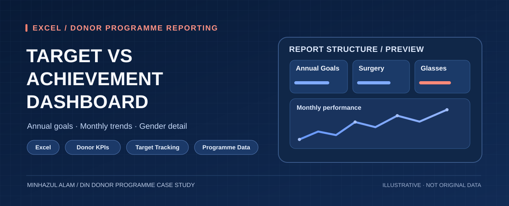

# Target vs Achievement Dashboard — DiN Donor Programme

**Project type:** Donor-funded programme monitoring & performance reporting  
**Donor:** DiN (Dak International Network)  
**Reporting context:** Quasem Foundation  
**Reporting period:** July 2025 – March 2026  
**Tools:** Microsoft Excel — dashboarding, data consolidation, performance analysis

## Project overview

This Excel dashboard supports **target-versus-achievement monitoring** for a programme supported by **DiN (Dak International Network)**, with reporting prepared in the context of **Quasem Foundation**. The workbook consolidates nine monthly programme summaries into an executive view, making it easier to review progress, identify shortfalls and communicate programme performance.

## What the workbook demonstrates

- **Executive dashboard:** Programme objective tracking, key performance indicators and overall progress.
- **Target vs achievement:** Planned targets, actual achievements, variance, completion rates and balances.
- **Monthly monitoring:** Month-by-month comparisons and patterns across programme activities.
- **Programme activity analysis:** Cataract surgeries, reading glasses distribution, registration, refraction and related service indicators.
- **Gender-disaggregated reporting:** Activity performance broken down by gender and month.
- **Source traceability:** A source log documenting the monthly workbooks consolidated into the report.

## Workbook structure

| Sheet | Purpose |
|---|---|
| `Dashboard` | Executive summary and KPI monitoring |
| `Combined Summary` | Consolidated monthly targets and achievements |
| `Gender Detail` | Gender-based activity analysis |
| `Source Log` | Reporting-source traceability |

## Analytical capabilities showcased

- Consolidating multiple monthly Excel reports into a single monitoring framework.
- Comparing actual performance with targets and calculating gaps.
- Creating clear programme dashboards for management and donor reporting.
- Presenting month-level and demographic breakdowns for decision support.

## Data-sharing notice

This public repository contains **project documentation and an illustrative graphic**, **not the original source workbook or underlying programme data**. Exact KPI results, beneficiary information and donor reporting records should be shared only with appropriate authorization. The graphic illustrates analytical structure rather than displaying actual programme results.
